<p align="center"></p>

# AI Kubernetes API Generator

Transform natural language descriptions into Kubernetes Custom Resource Definitions (CRDs) and OpenAPI specifications.

## Overview

Generate Kubernetes APIs from plain English descriptions. This tool helps developers create Kubernetes Custom Resources by using AI to parse natural language requests and generate OpenAPI specs and CRD YAML files.

## What is and isn't real

A demo that oversells itself is worth less than one that tells you exactly where the edges are.

**Real:**

- **The AI generation path.** `examples/ai_demo.py` sends your description to an OpenRouter model (your key, your choice of model), parses the response into a pydantic-validated `CodegenRequest`, and emits an OpenAPI 3.0 spec plus CRD and sample-instance YAML.
- **The offline fallback path.** `examples/demo.py` runs the same generation pipeline with canned descriptions — no API key, no cluster needed. If you want to see the artifact shapes in 10 seconds, start here.
- **The library is importable and tested.** `src/ai_platform_generator` imports cleanly and `python3 -m pytest tests/ -v` runs 44 tests, all passing (verified on Python 3.14).
- **The CLI exists** (`ai_platform_generator/cli.py`: `interactive`, `generate`, `examples` commands via Click + Rich).

**Not exercised in this revision, and labelled as such:**

- **The kind cluster path.** `./run.sh demo` installs kubectl/kind, creates a cluster, generates APIs and applies the generated CRDs. That was the repo's original demo and the manifests in `generated_specs/` are its output, but this revision (2026-11-01) was verified offline only — no cluster was created. Treat the cluster path as untested since 2026-10.
- **MCP server generation requires an external tool** (`openapi-mcp-codegen`) that is not installed by this repo. Without it the generator degrades gracefully to K8s-controller generation only, and says so.

**Not in this tree, and that's the point:**

- The `docs/adr/` and `docs/ddd/` corpora and the v1.1.0 CHANGELOG entry describe a full hexagonal-architecture rewrite that was completed on the [`claude/adr-ddd-documentation-wcROb`](https://github.com/adventurewave-labs/AI-Kubernetes-API-Generator-Demo/tree/claude/adr-ddd-documentation-wcROb) branch (74 commits, May–June 2026) and **never merged to main**. Only the documentation landed. Six test files under `tests/` import that architecture; `tests/conftest.py` excludes them from the default run with a pointer to this note. See [the history section](#on-the-history-of-this-repo).

## Quick Start

### Prerequisites

- Python 3.8+ (tested on 3.14)
- Docker (running)
- curl (usually pre-installed)
- OpenRouter API key (free tier available)

**Note**: kubectl and kind are installed automatically by the demo script.

### One-Command Demo Setup

```bash
# Clone the repository
git clone https://github.com/adventurewave-labs/AI-Kubernetes-API-Generator-Demo.git
cd AI-Kubernetes-API-Generator-Demo

# Get your free OpenRouter API key from https://openrouter.ai
export OPENROUTER_API_KEY="your-openrouter-api-key-here"

# Run the complete demo
./run.sh demo
```

**The demo command automatically:**
1. Installs kubectl and kind CLI tools
2. Creates Kind cluster if needed
3. Generates Kubernetes APIs from natural language
4. Deploys CRDs and sample instances to the cluster
5. Shows running resources

### No API key? Run the offline demo

```bash
python examples/demo.py
```

Uses the same generation pipeline with canned descriptions and writes specs to `generated_specs/`. No key, no cluster.

### Manual Setup

If you prefer to install tools manually:

```bash
# Install kubectl and kind manually, then:
kind create cluster --name ai-platform-demo

# Run just the AI demo (no automatic setup)
python examples/ai_demo.py

# Deploy generated resources manually
kubectl apply -f generated_specs/kubernetes/databaseservice-crd.yaml
kubectl apply -f generated_specs/kubernetes/databaseservice-instance.yaml
```

### Verify Demo Results

After the demo completes, explore your new Kubernetes APIs:

```bash
# Check deployed custom resources
kubectl get crds | grep cnoe.io

# View your new API instances
kubectl get databaseservices.database.cnoe.io
kubectl describe databaseservice my-databaseservice-instance

# Explore the cluster
kubectl get all -A
```

## Usage Examples

Describe what you want to create in plain English:

- "PostgreSQL database clusters with replication and backup scheduling"
- "Redis cluster management with memory and CPU configuration"
- "Monitoring service API with configurable intervals and alerts"

### Generated Output

The AI generates these files:

- `generated_specs/database_demo.json` - OpenAPI 3.0 specification
- `generated_specs/kubernetes/databaseservice-crd.yaml` - Kubernetes CRD
- `generated_specs/kubernetes/databaseservice-instance.yaml` - Sample instance

### Example Generated CRD

```yaml
apiVersion: apiextensions.k8s.io/v1
kind: CustomResourceDefinition
metadata:
  name: databaseservices.database.cnoe.io
spec:
  group: database.cnoe.io
  versions:
  - name: v1alpha1
    served: true
    storage: true
    schema:
      openAPIV3Schema:
        type: object
        properties:
          spec:
            type: object
            properties:
              connectionString:
                type: string
                description: Database connection string
              backupSchedule:
                type: string
                description: Cron schedule for backups
              autoScaling:
                type: boolean
                description: Enable auto-scaling
```

## Testing

```bash
# Install dependencies (click is required by the CLI; it was missing from
# requirements.txt before 1.1.1)
pip install -r requirements.txt pytest

# Run tests — 44 tests, all passing
python3 -m pytest tests/ -v
```

Six files under `tests/` (`e2e/`, `integration/`, `performance/`, `unit/`, `validation/`) import the unmerged hexagonal architecture and are excluded by `tests/conftest.py`. The active suite is `test_agent.py`, `test_codegen.py`, and `test_cli.py`.

## Configuration

Required environment variables:

```bash
export OPENROUTER_API_KEY="your-openrouter-api-key"
export OPENROUTER_MODEL="liquid/lfm-2.5-2.6b:free"
```

The default model is free on OpenRouter and supports structured outputs, which this generator relies on. It replaced `meta-llama/llama-3.2-3b-instruct:free` in this revision — that model was withdrawn from OpenRouter, and every earlier reference to it was dead. Any model on [openrouter.ai/models](https://openrouter.ai/models) works; `examples/test_models.py` probes a shortlist of free models with your key.

Get your free API key from [OpenRouter.ai](https://openrouter.ai)

## How It Works

1. **Describe API**: Explain what you want in natural language
2. **AI Processing**: The AI parses your description into a structured request
3. **Generate Spec**: Creates OpenAPI 3.0 specification from the parsed request
4. **Deploy CRD**: Apply generated Kubernetes YAML to your cluster
5. **Use Resource**: Interact with your new custom resource

Example deployment:
```bash
kubectl apply -f generated_specs/kubernetes/databaseservice-crd.yaml
kubectl get databaseservices.database.cnoe.io
```

## On the history of this repo

Earlier states of this repository claimed more than the tree contained, and this section exists so it stays fixed.

- **Born October 2025** as "AI-Assisted Platform Extension Generator" with a working NL→CRD demo and a set of JS "swarm agent" scripts that produced analysis documents rather than software. The swarm scripts were removed in August 2026 ("dead swarm agent theater").
- **May–June 2026**, a 74-commit hexagonal/DDD rewrite (ADR-0001..0020) was completed on the `claude/adr-ddd-documentation-wcROb` branch. Its documentation and a v1.1.0 CHANGELOG describing it landed on main; the code did not. Until this revision the CHANGELOG therefore described an architecture main does not contain.
- **2026-08-24**, a commit appending `generate_crd_yaml()` to the library introduced a syntax error that made `ai_platform_generator` unimportable for over two months. Nothing caught it because main has no CI and the test suite did not collect. Fixed here.
- **2026-11-01** (this revision): the repo was unarchived, the import breakage fixed, the test suite made green again, the withdrawn default model replaced everywhere, and this README realigned with the tree. The unmerged branch is still there if anyone wants to finish that work; until then, main is the simple, working generator described above.

## Related

Part of the AdventureWave Labs Kubernetes demo lane:

- [**Agentic DevOps Extravaganza**](https://github.com/adventurewave-labs/agentic-devops-extravaganza) — K8sGPT and Robusta doing autonomous incident triage against a real Kubernetes API, mock or kind.
- [**noip-scanner**](https://github.com/adventurewave-labs/noip-scanner) — Kubernetes posture scanner with CIS control mappings, pipeline gates, and audit evidence bundles.
- [**moor-demo**](https://github.com/adventurewave-labs/moor-demo) — the Moor control-plane demo.

This repo is the **API-generation** corner of the lane: the others operate on clusters that exist; this one creates the APIs those workloads speak.

## Contributing

1. Fork the repository
2. Create a feature branch
3. Add tests for new functionality
4. Ensure all tests pass
5. Submit a pull request

## License

MIT License - see LICENSE file for details.

---

Built with [Pydantic](https://docs.pydantic.dev/) and follows [OpenAPI 3.0](https://swagger.io/specification/) standards.
